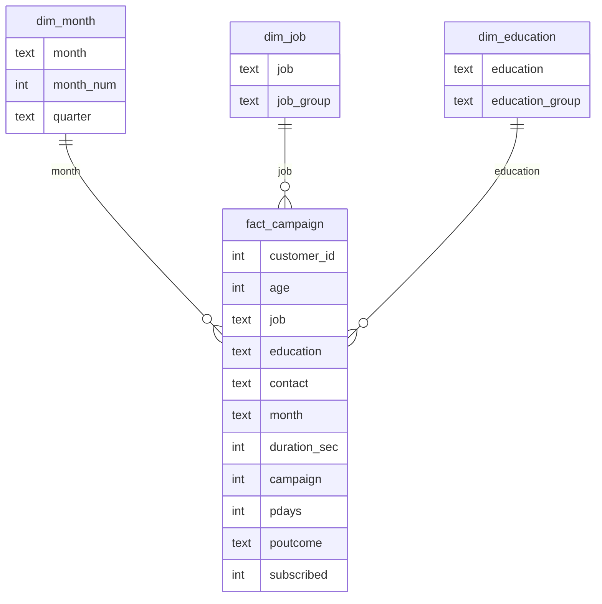

# Data model (star schema)

`fact_campaign` has one row per customer contacted. Power Query adds `age_band`, `duration_band`, `contacts_band`, `balance_band`.
`_Measures` holds only measures. `Cost per Contact` is the What-if parameter table (no relationships).

## Key definitions
| Term | Definition |
|---|---|
| Customer contacted | One row in the dataset |
| Subscription | Customer said yes to the term deposit (`subscribed = 1`) |
| Conversion rate | Subscriptions / customers contacted |
| Lift | Segment conversion rate / overall conversion rate (above 1 means better than average) |
| Contacts | Number of calls made to the customer in this campaign (`campaign` column) |
| Cost per subscription | (Total contacts x assumed cost per contact) / subscriptions |
| Previous campaign outcome | Result of an earlier campaign; "No previous campaign" if the customer was not contacted before |
